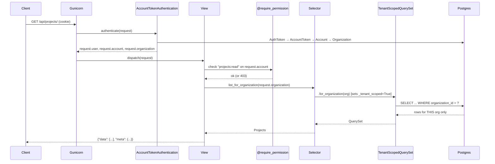
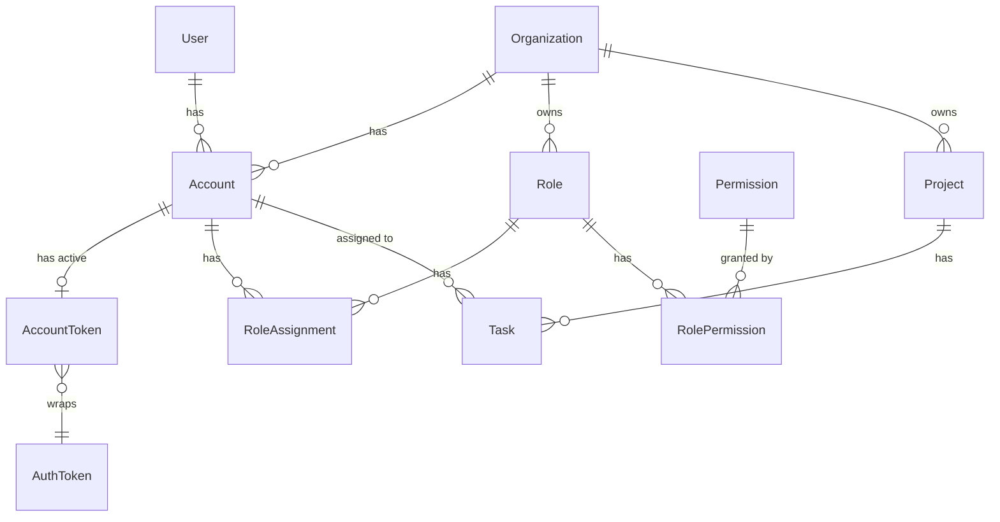

# django-saas-foundation

[](https://github.com/ademolaidowu/django-saas-foundation/actions/workflows/ci.yml)


A reusable Django SaaS foundation with multi-tenancy, account-scoped authentication, RBAC, audit trails, and tenant-isolated APIs.

## Why this exists

This repo is the working reference for the **Advanced Django** blog series — a production-grade multitenant SaaS backend built with row-level tenancy and account-scoped tokens, without reaching for `django-tenants` or JWT. The goal is to be *readable*: a senior engineer can scan it in five minutes and know what's load-bearing, and the design decisions that matter are frozen in six short ADRs.

## Quickstart

```bash
git clone https://github.com/ademolaidowu/django-saas-foundation.git
cd django-saas-foundation
cp .env.example .env
make up
```

The stack boots in ~30 seconds. Then:

- Swagger UI: <http://localhost:8000/api/docs/>
- Admin: <http://localhost:8000/admin/>
- Health: <http://localhost:8000/api/health/>

### Demo logins

The compose boot runs `seed_demo` by default (`SEED_DEMO=true`). Password for all four demo users is **`demopass123`**.

| Email | Organization | Role |
|---|---|---|
| `alice@acme.com` | Acme Corporation | Owner |
| `bob@acme.com` | Acme Corporation | Member |
| `carol@acme.com` | Acme Corporation | Viewer |
| `dave@both.com` | Globex Innovations (primary) + Acme (secondary) | Owner on Globex, Member on Acme |

Register a fresh account instead via `POST /api/auth/register/`.

### Common commands

```bash
make help         # list every target
make up           # start stack
make down         # stop stack
make logs         # tail api logs
make test         # pytest + coverage
make lint         # ruff + format check
make typecheck    # mypy
make check        # Django system check + migrations consistency
make seed         # seed_rbac + seed_demo
```

## Architecture

### Request lifecycle



The client never names the organization. It is derived from the token at authentication, filtered on at the query layer, and the two deny paths (cross-tenant 404 vs. same-tenant RBAC 403) never overlap.

### Core models



A `Token` is an `AuthToken` wrapped by an `AccountToken` which binds it to exactly one `Account`, which belongs to exactly one `Organization`. That chain is loaded in a single query on every request.

## How tenant isolation is enforced

Three independent, fail-closed layers:

1. **Token binding** — a Knox `AuthToken` and an `AccountToken` row are created together in one atomic transaction. The account on a token is immutable.
2. **Authentication** — on every request, `AccountTokenAuthentication` loads the chain `AuthToken → AccountToken → Account → Organization` in one query and attaches `request.user`, `request.account`, `request.organization`. If any link is missing, the request fails 401.
3. **Queryset guard** — `TenantScopedQuerySet.for_organization(org)` is the *only* way to make a tenant-scoped query evaluate. Every evaluation path (`_fetch_all`, `count`, `exists`, `get`, `update`, `delete`) raises `UnscopedQueryError` otherwise.

Cross-tenant access returns **404** (the resource doesn't exist in the user's world), not 403 (which would confirm it exists elsewhere). See [`docs/architecture.md`](docs/architecture.md) for the full walkthrough.

## How RBAC works

Four seeded system roles per organization, defined in [`apps/access/registry.py`](apps/access/registry.py):

| Role | Permissions |
|---|---|
| **Owner** | Everything, including `organization:manage`. Can't be removed if they're the last Owner (service-level invariant). |
| **Admin** | Everything except `organization:manage`. |
| **Member** | Domain CRUD: `projects:*`, `tasks:*`, `accounts:read`. |
| **Viewer** | Read-only: every `*:read` permission. |

Custom roles with any subset of permissions are created via `POST /api/access/roles/`. Permission checks happen in two places: the `@require_permission("code")` decorator gates endpoints, and `policies.py` modules handle object-level rules (e.g. `TaskPolicy.can_close` — only the assignee or an Owner/Admin can transition a task to `done`/`cancelled`).

### Adding a new permission

Say you need `invoices:read`:

1. Append to `apps/access/registry.py`:
   ```python
   PermissionDef("invoices:read", "View invoices."),
   ```
2. Decide which system roles get it. If it belongs to the full Admin set, nothing to do — `ADMIN_CODES` picks it up. Otherwise, edit the `SystemRoleDef.permission_codes` tuples.
3. Apply the registry update:
   ```bash
   uv run python manage.py seed_rbac
   ```
4. Gate the view:
   ```python
   @require_permission("invoices:read")
   def get(self, request): ...
   ```
5. Lock it into the role × endpoint matrix:
   ```python
   # tests/access/test_permission_matrix.py
   MATRIX[SystemRoleCode.VIEWER]["invoices:read"] = ALLOW
   ```

The seed command is idempotent, so step 3 is safe to re-run on any deploy.

## Project structure

```
apps/
├── core/        BaseModel, AuditTrailMixin, TenantScopedModel + guard, exceptions, pagination
├── tenants/     Organization
├── accounts/    User, Account, AccountToken, auth endpoints
├── access/      Permission, Role, RoleAssignment, @require_permission, seed_rbac
└── projects/    Project, Task — the example domain
```

Each app follows the same layered pattern:

```
apps/<app>/
├── models/              fields, constraints, indexes
├── serializers/
│   ├── input/           request validation
│   └── output/          response shape
├── selectors.py         reads — always tenant-scoped
├── services.py          writes — business rules, @transaction.atomic
├── policies.py          object-level authorization
├── views.py             thin — parse input, call service, serialize output
├── urls.py
├── constants.py
└── admin.py
```

The reference material for this pattern is the Advanced Django blog series:

- [Advanced Django: Models](https://www.ademolaidowu.com/blog/advanced-django-models)
- [Advanced Django: Querysets and Managers](https://www.ademolaidowu.com/blog/advanced-django-querysets)
- [Advanced Django: Selectors and Services](https://www.ademolaidowu.com/blog/advanced-django-selectors-services)
- [Advanced Django: Serializers](https://www.ademolaidowu.com/blog/advanced-django-serializers)
- [Advanced Django: Views and Permissions](https://www.ademolaidowu.com/blog/advanced-django-views-permissions)

## Design decisions

Short write-ups in `docs/decisions/`:

| ADR | Decision |
|---|---|
| [001](docs/decisions/001-row-level-tenancy-vs-schema-per-tenant.md) | Row-level tenancy, not schema-per-tenant (`django-tenants`). |
| [002](docs/decisions/002-account-scoped-tokens.md) | Account-scoped tokens, not user-scoped. |
| [003](docs/decisions/003-unscoped-query-prevention.md) | How unscoped queries are prevented. |
| [004](docs/decisions/004-public-uuids-alongside-integer-pks.md) | Public UUIDv7 alongside integer PKs. |
| [005](docs/decisions/005-404-not-403-for-cross-tenant.md) | 404 (not 403) for cross-tenant access. |
| [006](docs/decisions/006-middleware-driven-history-user.md) | Middleware-driven history-user attribution. |

## Roadmap

Not shipped; listed so the scope boundary is explicit.

- Subscription billing.
- Invitations by email (populates `AccountStatus.INVITED`).
- SSO via OIDC.
- Celery for background jobs + a `beat` schedule.
- Rate limiting (per-token, per-IP).
- React admin frontend.
- Per-tenant feature flags.
- codecov.io integration (dynamic coverage badge).
- Multi-arch Docker builds (arm64 + amd64).

## License

MIT.
